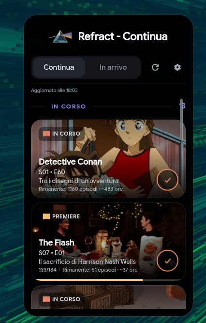
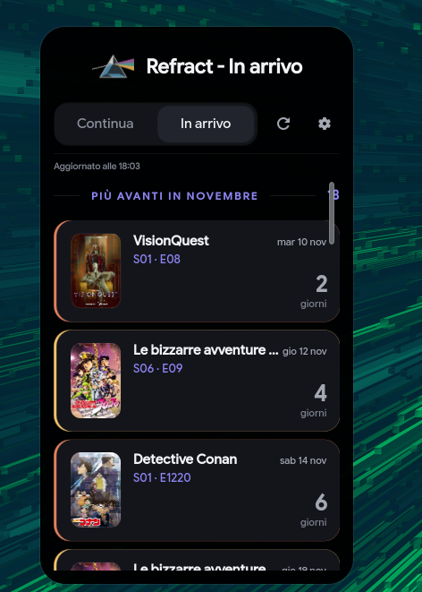
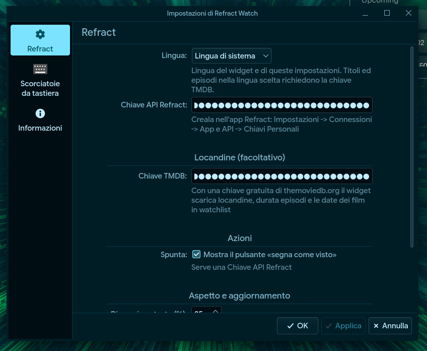
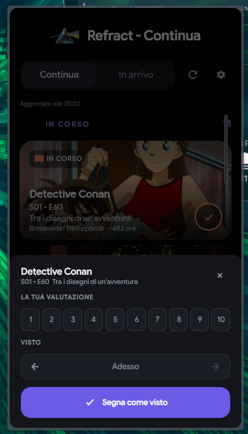
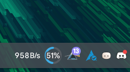

A KDE Plasma Widget for monitor TV Series/Anime on Refract

## 👤 Create Account
You need to create an account on the Refract app for use this widget

[](https://apps.apple.com/us/app/refract-movies-tv-anime/id6760271872)
[](https://play.google.com/store/apps/details?id=com.prism.refract)

## 📝 Requirements
| Dependencies | Version |
| --- | --- |
| KDE Plasma | 6 |
| Qt | 6.5 + |
| kpackagetool | 6 |
| Graphic Acceleration | On (suggested) |

## ⚙️ Installation
```sh
kpackagetool6 -t Plasma/Applet -u ~/Download/refractwatch.plasmoid
systemctl --user restart plasma-plasmashell.service
```

## 📋 Features:
- ### 📺 Monitoring
    
    
- ### 🎚️ Setup
    
- ### ✅ Sign as seen
    
- ### 🏠 In bottom bar
    